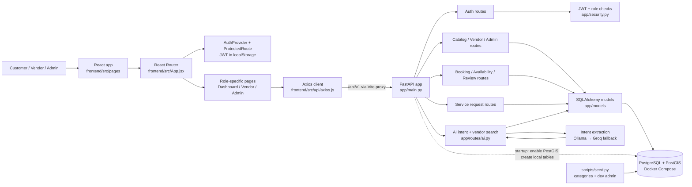
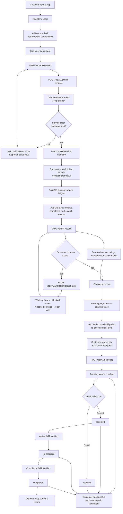
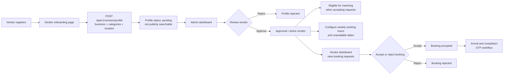

# DailyDrill

DailyDrill is a Palghar-focused home-services marketplace. Customers can find
local service professionals, compare database-backed details, check availability,
and request a booking. Vendors manage their profiles and service requests, while
admins review vendor applications.

## Project flow graphs

These diagrams provide a visual map from the browser screens to the API,
database, and the main customer/vendor workflows. GitHub renders the Mermaid
diagrams below directly.

### System architecture



### Customer search-to-booking flow



### Vendor onboarding and admin approval



### Where to look in the code

| Area | Main files | Responsibility |
|---|---|---|
| App startup and API wiring | `app/main.py` | Creates the FastAPI app, initializes local database tables, and mounts routers under `/api/v1`. |
| Frontend routes and access control | `frontend/src/App.jsx`, `frontend/src/components/ProtectedRoute.jsx` | Maps URLs to pages and limits pages by role. |
| Login session | `frontend/src/context/AuthProvider.jsx`, `app/api/routes/auth.py`, `app/security.py` | Login/register, JWT storage, current-user lookup, and role checks. |
| Customer agent and results | `frontend/src/pages/Dashboard.jsx`, `app/routes/ai.py` | Service search, comparison, Palghar matching, and customer booking/status UI. |
| Vendor onboarding and operations | `frontend/src/pages/VendorOnboarding.jsx`, `frontend/src/pages/VendorDashboard.jsx`, `app/api/routes/vendors.py`, `app/api/routes/admin.py` | Profile creation, approval, and handling vendor requests. |
| Availability and bookings | `frontend/src/pages/BookingPage.jsx`, `app/api/routes/availability.py`, `app/api/routes/bookings.py` | Real slot calculation, booking creation, status changes, and OTP verification. |
| Database definitions | `app/models/`, `app/schemas/`, `app/db.py` | SQLAlchemy tables, API validation/response shapes, and database sessions. |
| Local infrastructure and tests | `docker-compose.yml`, `scripts/seed.py`, `tests/` | PostGIS database, development seed data, and backend test cases. |

## How the project works

### Architecture

- **Frontend:** React 19 and Vite (`frontend/`). React Router handles customer,
  vendor, and admin pages. Axios sends API requests to `/api/v1`.
- **API:** FastAPI (`app/`) provides authentication and marketplace endpoints.
  The API uses SQLAlchemy models and Pydantic request/response schemas.
- **Database:** PostgreSQL with PostGIS, run locally with Docker Compose. Vendor
  locations are used for geographic distance searches.
- **AI request understanding:** `app/routes/ai.py` asks Ollama to extract the
  requested service and problem details. If Ollama is unavailable, it tries
  Groq. The model interprets the request; vendor facts and matches are queried
  from the database.

### Customer search and booking flow

1. A customer registers or logs in. The API returns a bearer token; the frontend
   stores it in local storage and sends it with authenticated requests.
2. The customer describes the requested service in the dashboard.
   `POST /api/v1/ai/find-vendors` converts the message into a service intent.
   If the service is unclear or unsupported, the API asks for clarification or
   returns the active service categories.
3. The API matches the service to an active category in PostgreSQL. Vendor
   results are restricted to approved, active vendors accepting requests and
   matching that category. The agent's default search center is Palghar; PostGIS
   calculates distance from stored vendor coordinates.
4. Results include facts read from the database, such as distance, customer
   reviews, completed bookings, and match reasons. The dashboard can sort the
   results by distance, reviews, or completed work. These are comparisons, not
   guarantees of service quality.
5. If the customer chooses a date, the dashboard requests availability for the
   listed vendors. Availability is computed from each vendor's working hours,
   blocked dates, existing bookings, and future time slots. It can change before
   a booking is submitted.
6. The customer selects a vendor and continues to booking. The booking page
   fetches the vendor's current slots again, pre-fills still-valid search
   details, and requires the customer to confirm the request.
7. A new booking starts as **pending**. The vendor can accept or reject it.
   Accepted bookings can move to in-progress and completed; arrival and
   completion OTPs verify those transitions. Customers can track the status,
   cancel eligible requests, and review completed work.

### Vendor and admin flow

1. A user registers with the vendor role and submits a profile, offered
   categories, and location.
2. New vendor profiles start pending and are not available in public search.
3. An admin reviews pending profiles and approves or rejects them. Approved,
   active vendors can manage their availability and booking requests from the
   vendor dashboard.
4. Vendors configure weekly working hours and unavailable dates, accept or
   reject booking requests, and use OTP verification as a service progresses.

## Requirements

- Windows PowerShell (commands below use Windows paths and syntax)
- Python 3.11 or newer
- Node.js and npm
- Docker Desktop
- Ollama for local AI intent extraction, or a Groq API key as fallback

## Local setup

Run commands from the project root unless a command changes directory.

### 1. Configure Python and environment

```powershell
py -3.11 -m venv .venv
.venv\Scripts\Activate.ps1
python -m pip install -r requirements.txt
Copy-Item .env.example .env
```

Edit `.env` and set a long, unique `JWT_SECRET`. Keep `.env` local; it is
intentionally ignored by Git. Add a `GEOAPIFY_API_KEY` if using the location
geocoding endpoint.

The AI provider reads `GROQ_API_KEY`, `OLLAMA_BASE_URL`, and `OLLAMA_MODEL` from
the API process environment. Ollama defaults to `http://localhost:11434` and
model `llama3.2:3b`; install Ollama and make that model available to use the
local provider. Groq is tried when Ollama is unavailable. Set `GROQ_API_KEY` in
the PowerShell session before starting the API if using the fallback:

```powershell
$env:GROQ_API_KEY = "your-groq-api-key"
```

Do not commit real API keys or secrets.

### 2. Start PostgreSQL/PostGIS

```powershell
docker compose up -d
docker compose ps
```

Wait until the `db` service is healthy. The current compose file uses a
development-only database and password; change them before using a shared or
production environment.

### 3. Start the API and initialize database tables

The API startup creates the PostGIS extension and SQLAlchemy tables for local
development. Start it now and leave this terminal running:

```powershell
python -m uvicorn app.main:app --reload --host 127.0.0.1 --port 8000
```

Wait for the API startup to finish before proceeding.

### 4. Seed development data

Open another terminal at the project root, activate the virtual environment,
and seed service categories and a development admin account:

```powershell
.venv\Scripts\Activate.ps1
python -m scripts.seed
```

The seed script creates `admin@dailydrill.local` with the development password
`ChangeMe123!`. Change or remove this account before exposing the app beyond
trusted development testing.

Check `http://127.0.0.1:8000/health` and browse the API at
`http://127.0.0.1:8000/docs`.

### 5. Install and start the frontend

In a separate terminal:

```powershell
Set-Location frontend
npm ci
npm run dev
```

Open the URL Vite prints, usually `http://localhost:5173`. Vite proxies
`/api` requests to `http://127.0.0.1:8000`, so the browser uses the same
frontend origin for API calls.

## Testing and production build

```powershell
# Frontend checks
Set-Location frontend
npm run lint
npm run build

# From the project root, with the Python environment activated
Set-Location ..
python -m pytest -q
```

If pytest is not installed in the active environment, install it there with
`python -m pip install pytest`.

## Testing on a phone over a different network

For temporary development testing, expose the Vite frontend through ngrok. Keep
the API running locally; Vite forwards API requests to it.

1. Start the API and frontend as described above.
2. In another terminal, run:

   ```powershell
   ngrok http 5173
   ```

3. Open the HTTPS forwarding URL printed by ngrok on the phone.
4. If Vite rejects the ngrok hostname, add that exact hostname to
   `server.allowedHosts` in `frontend/vite.config.js`, then restart Vite.

This development server is not a production deployment. Anyone with the tunnel
URL may be able to reach it; use test accounts and non-production data only.

## Main folders

```text
app/
  api/routes/       Authentication, catalog, vendors, bookings, availability,
                    reviews, service requests, and admin endpoints
  core/             Application settings
  models/           SQLAlchemy database models
  routes/ai.py      AI intent extraction and Palghar vendor search
  schemas/          Pydantic API schemas
frontend/
  src/context/      Login session and user state
  src/pages/        Customer, vendor, and admin screens
  src/api/axios.js  Shared API client
scripts/            Database seed/bootstrap scripts
tests/              Backend tests
```

## Notes before deployment

- `Base.metadata.create_all()` is currently used for local bootstrap. Add and
  apply database migrations (for example, Alembic) before shared deployments.
- Rotate secrets if they were ever committed or shared. Adding a file to
  `.gitignore` does not remove it from existing Git history.
- Replace development database credentials, admin credentials, and secrets;
  configure production CORS, HTTPS, logging, backups, and access controls before
  public launch.
